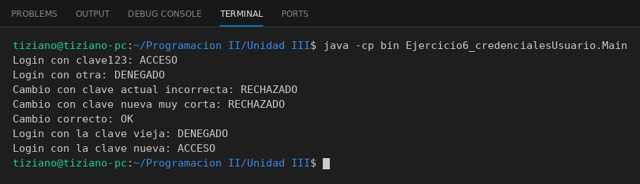

# Usuario

Programación II - Unidad 3 - Ejercicio 6

## Consigna
Modelar la clase aplicando encapsulamiento: atributos privados y métodos públicos que validan antes de modificar el estado. Un usuario cuya contraseña nunca se expone.

## Lógica
- La contraseña no tiene getter.
- `validarCredenciales(password)` compara sin revelar el atributo.
- `cambiarPassword(actual, nueva)` exige la clave actual y una nueva de al menos 6 caracteres distinta de la anterior.
- `Main` prueba cambios exitosos y fallidos y el inicio de sesión.

## Ejecución

